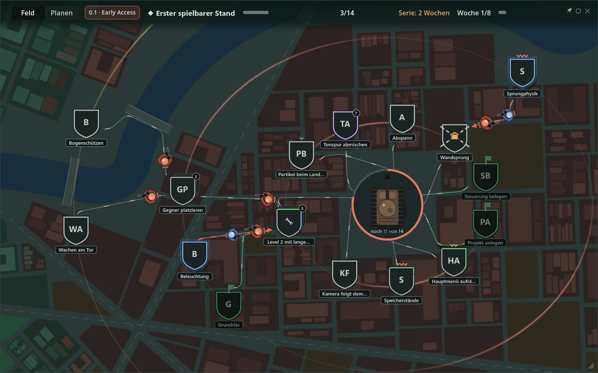
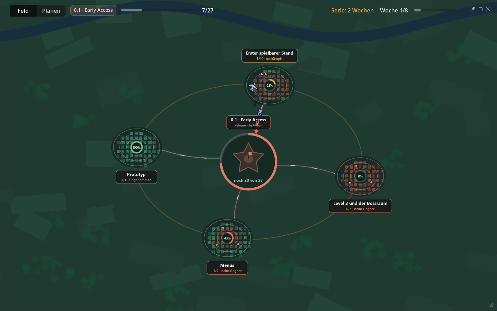
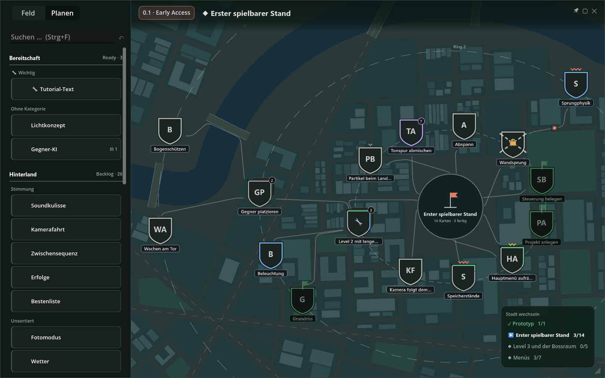
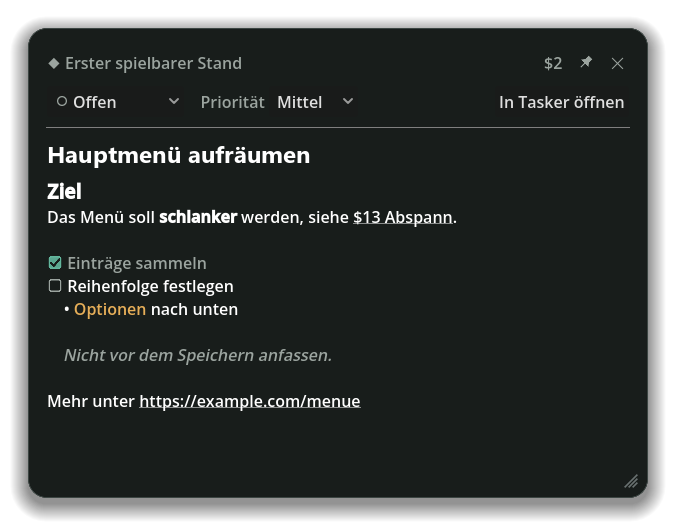
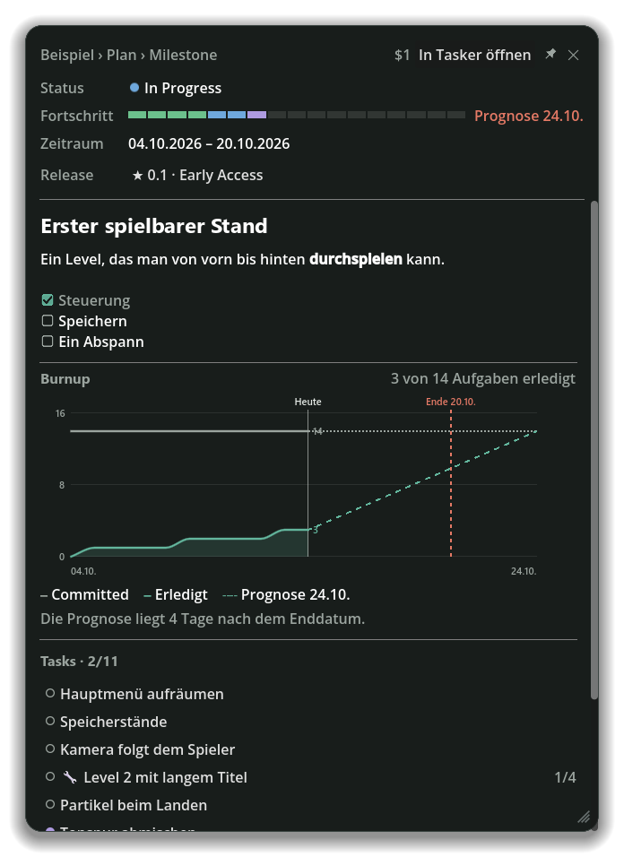
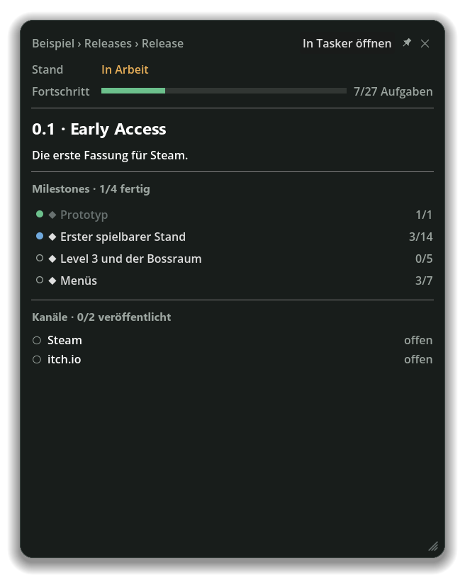

# Tasker für Godot

Editor-Addon, das [Tasker](https://github.com/tomate-salat/tasker) in den Godot-Editor holt:
Aufgaben sehen, suchen und managen, ohne den Editor zu verlassen.

> **Voraussetzung:** Das Addon ist ein Client für Tasker und funktioniert nur mit einem laufenden
> Tasker-Server. Tasker ist ein selbst gehostetes Projektmanagement-Werkzeug für Solo-Entwickler –
> Einrichtung und Betrieb stehen im [Tasker-Repository](https://github.com/tomate-salat/tasker).



## Bilder

Alle Bilder stammen aus den Beispieldaten des Addons.

**Feldzugskarte:** alle Milestones eines Releases als Städte rund um das Ziel.



**Planen:** links der Vorrat aus Bereitschaft und Backlog, rechts der Lageplan, auf den die Karten verteilt werden.



**Aufgabe, Milestone und Release** in eigenen Fenstern, mit Burnup und Prognose.

| Aufgabe | Milestone | Release |
|---|---|---|
|  |  |  |

## Was das Addon kann

- **Dock** mit dem laufenden Milestone als Karten: im Spiel, offen, gesperrt. Statuswechsel per
  Rechtsklick, Doppelklick öffnet die Aufgabe.
- **Aufgabenfenster** mit gerenderter Beschreibung (Markdown, Checklisten, Bilder, Zeichnungen,
  Verweise wie `$142`), Status und Prio änderbar, „In Tasker öffnen“ im Browser oder in der
  installierten Web-App.
- **Suche** im Dock und als Popup (Strg+Alt+T oder Befehlspalette „Tasker: Aufgabe suchen“).
- **Tisch** – ein eigenes Editor-Fenster (Werkzeug-Menü „Tasker-Tisch“), das sich auf einen
  zweiten Monitor schieben lässt:
  - **Feld:** der laufende Milestone als Stadt. Was eine Aufgabe noch braucht, sitzt als Gegner
    auf ihr; ein Klick nimmt sie in Arbeit und schickt Truppen los, ein Doppelklick öffnet sie. Dazu Wochenziel, Serie
    und eine Ablage, was in welcher Woche erledigt wurde.
  - **Feldzugskarte:** alle Milestones eines Releases auf einen Blick. Um die Festung stehen die
    Nebenquests als Stellungen – Mörser, Raketenwerfer, Feuerstellung oder Flugplatz, je nach
    Größe –, die mit der Checkliste aufgebaut werden und feuern, sobald die Aufgabe erledigt ist.
    Ein Klick (oder Hineinzoomen) öffnet eine; dort werden Kästchen abgehakt und Unteraufgaben in Arbeit genommen.
  - **Planen:** Aufgaben aus Bereitschaft und Backlog auf die Milestones verteilen. Auf der Ebene
    des Releases die Nebenquests auf die Festung ziehen – sie zählen als Bonus, nicht dafür, dass
    das Release bereit ist.
- **Milestone- und Release-Fenster** mit Fortschritt, Burnup und Prognose; das Release-Fenster
  zeigt auch den Bonus.
- **Karten in Szenen:** Aufgaben lassen sich an Nodes hängen und erscheinen im Viewport an ihnen –
  auch an jeder Instanz eines Prefabs, an dem sie hängen.
- **Schnellanlegen mit Claude** (Strg+Alt+N, „+“ im Dock, Kontextmenü im Szenenbaum): eine
  Beobachtung aufschreiben, und Claude (über die Claude-CLI) macht daraus eine Aufgabe mit Kontext,
  Akzeptanzkriterien, To-do und offenen Fragen, angehängt an die betroffenen Nodes. Im
  Aufgabenfenster nimmt Claude Anweisungen entgegen („das Addon heißt Dialogic“).
- **In Godot verfeinern:** eine Aufgabe aus der Tasker-Web-App an den offenen Editor schicken.
- **MCP-Server für Claude Code** (optional): Claude Code kann die offene Szene und das laufende
  Spiel lesen, Aufgaben anlegen und an Nodes hängen.

## Installation

1. Den Ordner `addons/tasker` in das eigene Godot-Projekt kopieren (Godot 4.7, reines GDScript).
2. Unter *Projekt → Projekteinstellungen → Plugins* „Tasker“ aktivieren.
3. Im Werkzeug-Menü *Tasker-Einstellungen …* öffnen und eintragen:
   - **Server:** Adresse des Tasker-Servers
   - **Token:** ein Zugangs-Token aus dem Tasker-Profil (`tsk_…`)
   - **Projekt:** das Tasker-Projekt, zu dem dieses Godot-Projekt gehört

Server und Token liegen in den Editor-Einstellungen und gelten für alle Projekte auf dem Rechner,
die Projektwahl liegt unversioniert unter `.godot/`. Im Repository landet davon nichts.

### Claude Code anbinden (optional)

In den Tasker-Einstellungen unter „Claude Code“ den MCP-Server einschalten (Vorgabe-Port 9309,
nur auf `127.0.0.1`, mit eigenem Kennwort), den angezeigten Befehl kopieren und im Terminal
ausführen.

Für den Blick ins laufende Spiel trägt das Addon bei eingeschaltetem MCP-Server den Autoload
`TaskerProbe` in `project.godot` ein. Er antwortet nur bei einem Start aus dem Editor, liest nur
und wird beim Abschalten des Addons wieder entfernt.

## Entwicklung

Dieses Repository ist selbst ein Godot-Projekt, in dem das Addon aktiviert ist. Tests:

```bash
godot --headless --path . -s tests/run_tests.gd
```

Die Bilder in `docs/screenshots/` entstehen aus den Beispieldaten neu (öffnet kurz ein Fenster):

```bash
godot --path . -s tests/readme_shots.gd
```

## Lizenz

[MIT](LICENSE)
